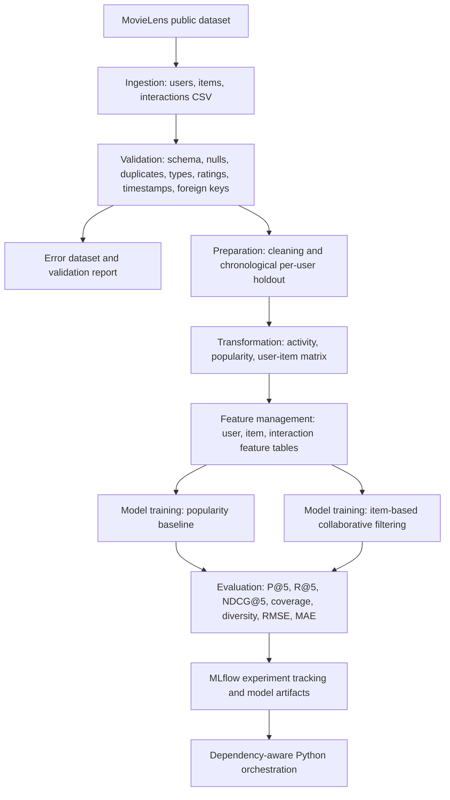

# End-to-End Data Management Pipeline for a Recommendation System

## 1. Project overview
This project implements an end-to-end movie recommendation data pipeline using the public **MovieLens Latest Small** dataset. It covers ingestion, automated validation, cleaning, time-based splitting, transformation, reusable feature management, two recommendation models, evaluation, experiment tracking, and dependency-aware orchestration.

**Models**
1. Popularity-based recommender (non-personalized baseline).
2. Item-based collaborative filtering (personalized recommender).

## 2. Architecture



## 3. Dataset and data design
Source: https://grouplens.org/datasets/movielens/

The pipeline downloads `ml-latest-small` automatically. It contains `ratings.csv` and `movies.csv`. The project creates `users.csv` from distinct observed `userId` values because MovieLens Latest Small does not include demographic user profiles. This is documented rather than fabricating personal attributes.

- **Users:** `userId`, `user_source`
- **Items:** `movieId`, `title`, `genres`
- **Interactions:** `userId`, `movieId`, `rating`, `timestamp`

## 4. Pipeline stages
1. **Ingestion:** Downloads and extracts the public dataset, then writes three raw CSV entities.
2. **Validation:** Checks missing identifiers/values, duplicate IDs and interactions, numeric types, rating range (0.5–5.0), timestamp parsing, and user/item referential integrity. Invalid interaction records are saved under `data/errors/`.
3. **Preparation:** Removes invalid and duplicate rows, standardizes timestamp fields, and creates a chronological per-user holdout. All interactions at each eligible user's latest timestamp are held out for testing; earlier timestamps remain in training.
4. **Transformation:** Creates user activity summaries, item popularity statistics, and a user-item rating matrix.
5. **Feature management:** Creates reusable user, item, and interaction feature tables plus `feature_catalog.csv`.
6. **Training:** Fits a popularity baseline and item-based collaborative filtering using cosine similarity.
7. **Evaluation:** Reports Precision@5, Recall@5, NDCG@5, catalog coverage, intra-list genre diversity, RMSE, and MAE. Ranking relevance is defined as a held-out rating >= 4.0.
8. **Tracking and orchestration:** MLflow logs model parameters and metrics. A dependency-aware Python workflow runs all stages in order and records task states.

## 5. Setup
Python 3.10–3.12 is recommended.

### Windows PowerShell
```powershell
py -3.11 -m venv .venv
.venv\Scripts\Activate.ps1
python -m pip install --upgrade pip
pip install -r requirements.txt
```

### Ubuntu / WSL
```bash
python3 -m venv .venv
source .venv/bin/activate
python -m pip install --upgrade pip
pip install -r requirements.txt
```

## 6. Run the complete pipeline
From the repository root:
```bash
python run_pipeline.py
```
The first run needs internet access to download MovieLens. A successful run prints `PIPELINE_RUN_SUMMARY` with every task marked `SUCCESS`.

## 7. Run individual stages (useful for screenshot evidence)
Run these from the repository root, in order, after installing dependencies:
```bash
python -m src.ingestion.ingest
python -m src.validation.validate
python -m src.preparation.prepare
python -m src.transformation.transform
python -m src.features.build_features
python -m src.training.models
python -m src.evaluation.evaluate
```
For the final reproducibility check, run `python run_pipeline.py` and capture the complete successful task summary. Individual-stage execution is optional; the end-to-end orchestration run is the authoritative complete workflow.

## 8. Inspect outputs
- `data/raw/`: downloaded source CSV files
- `data/processed/`: cleaned data and temporal train/test datasets
- `data/errors/`: invalid interaction records
- `data/features/`: summaries, matrix, and reusable features
- `models/`: serialized trained models
- `reports/validation_report.json`: automated validation results
- `reports/model_comparison.csv`: comparison of both models
- `reports/evaluation_results.json`: complete evaluation metrics
- `mlruns/`: MLflow experiment tracking
- `logs/pipeline_run.json`: orchestration task status

## 9. MLflow UI
After the pipeline has completed:
```bash
mlflow ui --backend-store-uri ./mlruns --host 127.0.0.1 --port 5000
```
Open http://127.0.0.1:5000 and capture the experiment runs and metrics.

## 10. Scheduling
For a recurring run every 24 hours (the first run starts immediately):
```bash
python run_scheduled_pipeline.py --interval-hours 24 --run-immediately
```
Stop the scheduler with Ctrl+C. For production deployment, the one-shot `python run_pipeline.py` command can also be registered with Windows Task Scheduler or Linux cron. The scheduler is intentionally separate from the pipeline DAG so the same pipeline can be run manually, on a timer, or by an external scheduler.

## 11. Reproducibility and design decisions
- Source data is downloaded from a documented public source.
- The chronological split avoids random leakage from future interactions into training.
- All derived user/item features are computed from training data only.
- Invalid records are separated and validation checks are reported.
- The workflow enforces stage dependencies and writes a run summary.
- MLflow records model parameters, metrics, and the validation report artifact.

## 12. Limitations
- MovieLens Latest Small is a relatively small movie-rating dataset and does not represent all production e-commerce traffic.
- The dataset does not include user demographics, so the users table contains IDs and source provenance only.
- A single latest-event holdout is simple and reproducible but does not capture multiple future interactions.
- Item-based collaborative filtering can be memory-intensive on much larger catalogs because the item similarity matrix is dense.
- Diversity uses genre-set Jaccard distance as a transparent proxy for recommendation variety.

## 13. Submission evidence
Capture genuine screenshots after execution and save them in `reports/screenshots/` using the filenames listed in `reports/screenshots/README.txt`. Then run:
```bash
python build_submission_pdf.py --github-url https://github.com/YOUR_USERNAME/YOUR_REPOSITORY
```
The script creates `reports/Final_Submission.pdf`, containing the short report and screenshot appendix. Replace the example GitHub URL with your actual public repository URL before generating the final PDF.
